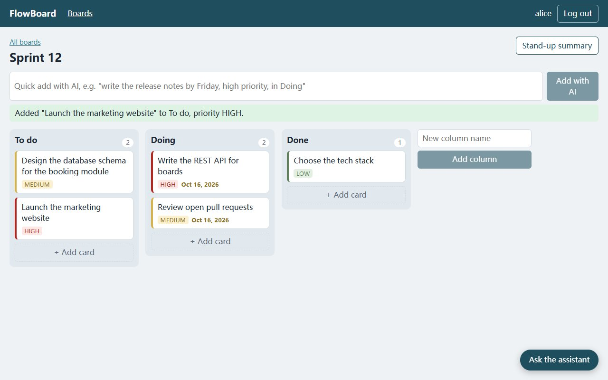
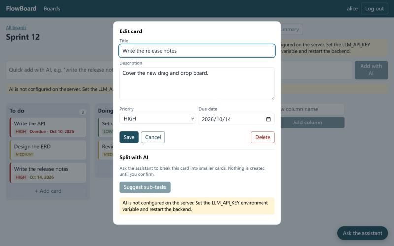
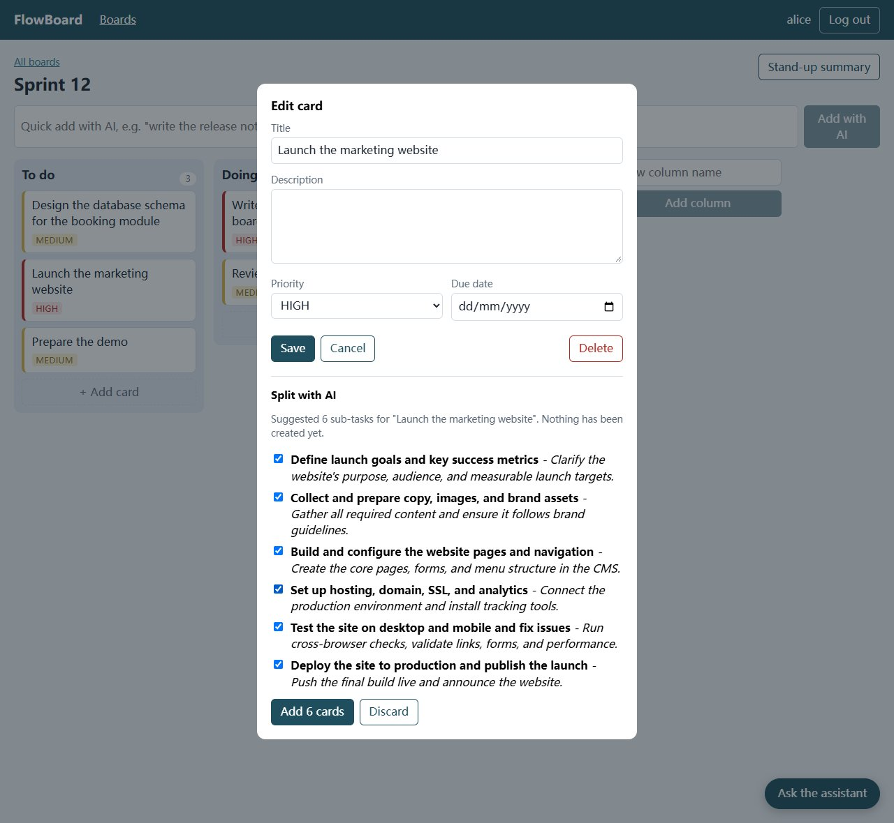

# FlowBoard

A small Trello-style kanban board with an AI assistant. Users register, create boards, add columns and cards, and
drag cards between columns. Five AI features sit on top: describe a card in one sentence, split a card into
sub-tasks, get a stand-up summary, and chat with an assistant that can read the board and create cards.

- **Backend:** Java 17, Spring Boot 3.5, Spring Security (JWT), Spring Data JPA, Spring AI
- **Frontend:** React 19, TypeScript, Vite 7, TanStack Query, dnd-kit
- **Tests:** 56 backend tests (JUnit 5, MockMvc) and 18 frontend unit tests (Vitest)



| Card editor | Split a card with AI |
|---|---|
|  |  |

> The screenshots were taken on 2026-10-15 in the real web interface, with the backend talking to DeepSeek
> `deepseek-flash`: the AI texts in `board`, `ai-split`, `ai-standup` and `ai-assistant` were written by the model.

## Features

| Area | What it does |
|---|---|
| Accounts | Register, log in, JWT sessions, automatic log-out when the token is no longer valid |
| Boards | Create boards (optionally with To do / Doing / Done columns), add columns |
| Cards | Create, edit (title, description, priority, due date), delete; overdue and due-soon dates are highlighted |
| Drag and drop | Reorder inside a column, move between columns, drop into an empty column. The screen updates at once and rolls back if the server refuses the move |
| AI: quick add | One sentence becomes a card: `write the release notes by Friday, high priority, in Doing` |
| AI: split | Suggests 3-6 sub-tasks for a card; nothing is created until you tick and confirm them |
| AI: stand-up | A short briefing of the board. The counts and the overdue / due-soon lists are computed by the server, only the wording comes from the model |
| AI: assistant | A chat widget whose model can read your board and create cards through tools. Each tool call is shown as a badge |

## Quick start

You need JDK 17, Maven and Node.js 20 or newer. On this project's author machine `JAVA_HOME` points at a folder
that does not exist, so set it for the terminal first (adjust the path to your JDK):

```powershell
$env:JAVA_HOME = 'D:\java learning\javase-jdk'
$env:Path = "$env:JAVA_HOME\bin;$env:Path"
```

**1. Backend** - http://localhost:8081 (Swagger UI at `/swagger-ui.html`):

```powershell
cd backend
mvn spring-boot:run
```

**2. Frontend** - http://localhost:5174 (Vite proxies `/api` to the backend, so no CORS setup is needed):

```powershell
cd frontend
npm install
npm run dev
```

Open http://localhost:5174, register, and create a board. Data is stored in `backend/data/` (a file-based H2
database in PostgreSQL mode, so no database has to be installed); stop the backend and delete that folder to start
clean.

## Turning the AI on

The AI endpoints need an API key of any OpenAI-compatible provider. DeepSeek is the default:

```powershell
$env:LLM_API_KEY  = 'sk-...'                       # required; never put it in a file
$env:LLM_BASE_URL = 'https://api.deepseek.com'     # optional, this is the default
$env:LLM_MODEL    = 'deepseek-flash'                # optional, this is the default
cd backend
mvn spring-boot:run
```

Without a key the application starts normally; the AI buttons show "AI is not configured" and the AI endpoints
answer `503`. To switch provider only these three variables change.

**Trying the AI interface without a key:** `tools/fake-llm.mjs` is a tiny server that speaks the OpenAI protocol
and answers with prepared text. It is *not* a model - it only lets you click through the AI features:

```powershell
node tools/fake-llm.mjs                                   # terminal 1: listens on 127.0.0.1:9099
$env:LLM_BASE_URL = 'http://127.0.0.1:9099'; $env:LLM_API_KEY = 'stand-in-key'
cd backend; mvn spring-boot:run                           # terminal 2
```

## Tests

```powershell
cd backend;  mvn test            # 56 tests; uses an in-memory database and a fake model server
cd frontend; npm test            # 18 unit tests (move algorithm, due dates, drag ids)
cd frontend; npm run lint        # ESLint
cd frontend; npm run build       # type-check + production build
```

The AI tests never call a real model: `AiFakeModelIntegrationTest` starts a fake OpenAI-compatible HTTP server
and checks the whole path (HTTP -> Spring AI -> tools -> services -> database), including what the model is
sent and how its answers are validated.

## Project layout

```
backend/    Spring Boot application (REST API, security, persistence, AI layer)
frontend/   React single-page application
tools/      fake-llm.mjs - scripted stand-in for a language model (to click through the AI features without a key)
docs/       screenshots used by this README
```

## Known limitations

- A board has one owner; there are no members, comments or real-time sync (reload to see changes).
- No delete for boards and columns, and no rename.
- Concurrent edits to the same column can leave two cards with the same position until the next move.
- The PostgreSQL profile (`--spring.profiles.active=postgres`) is configured but has never been run.
- The automated tests use a scripted stand-in model. The AI features were tried against DeepSeek `deepseek-flash`
  through the HTTP API on 2026-10-14 and through the web interface on 2026-10-15 (the screenshots). That was a
  handful of requests, not a systematic evaluation; it did find two prompt problems (stand-up wording, Markdown
  in chat) that the scripted model could not reveal, both fixed.
- `JWT_SECRET` has a development default; any real deployment must set it.
